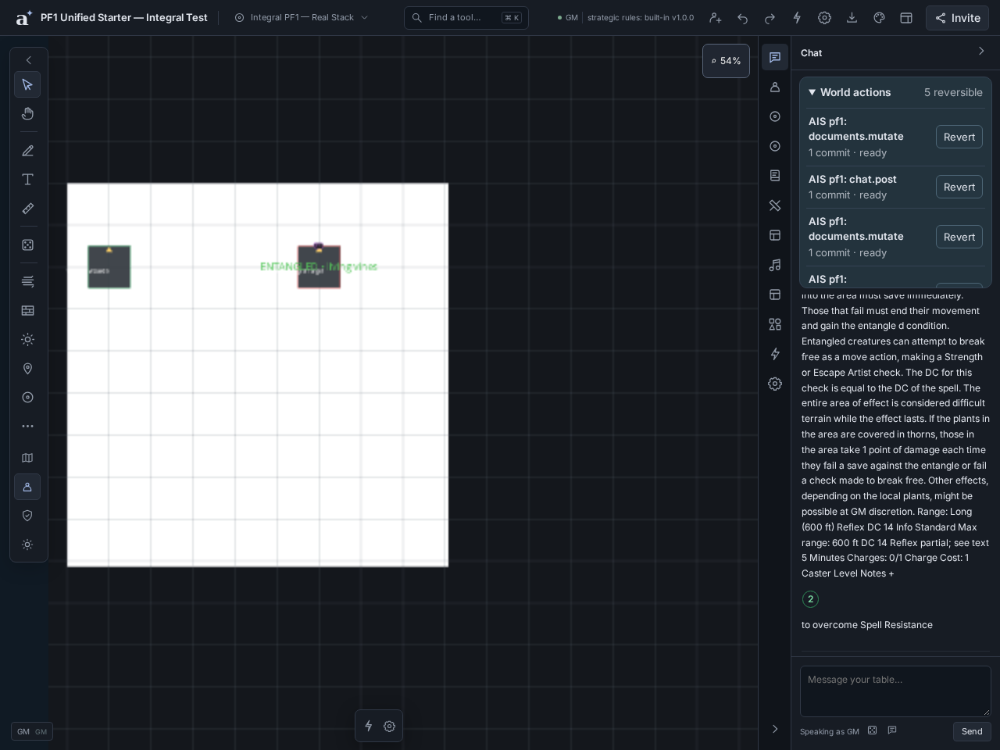

# Entangle: native FX Wizard ↔ genuine Foundry PF1 mechanics

**Run and passed in Chromium, 2026-10-17.** This is a real upstream Entangle
scenario inside the unified starter, not the native PF1 tactical-rule substitute.

## Run it yourself

Import `dist/worlds/pf1e-unified-starter-1.0.0.zip`. Approve the adapter and all
four upstream packages in Settings, then reload as instructed by the journal.

1. Open **Macros → FX Wizard**. Edit **Entangle — Native linked vines**. It is a
   persistent, target-anchored native text timeline, already bound to Valtiel's
   actual upstream Entangle item. Replace its text/art in the normal Wizard if
   desired; the test edits and saves this exact binding through that UI.
2. Open **Macros → Script macros**. Select each of the four Entangle controls,
   inspect its source and grants, tick the revision-review checkbox, and choose
   **Approve & save revision**. Imported scripts are deliberately **not approved**
   by the archive. No console commands or test globals are needed to run them.
3. Run **Entangle 1 — Cast (review first)**. This invokes PF1's real `Item.use`,
   uses the documented no-template quickcast option, and consumes preparation.
4. Resolve the Orc's Reflex save through PF1. **Only on a failed save**, run
   **Entangle 2 — GM confirms failed save**. PF1's actual `setCondition` creates
   the entangled ActiveEffect and derives its penalties. Native FX follows that
   committed effect; it does not decide saves or invent mechanical changes.
5. Run **Entangle 3 — Release / dismiss**. PF1 removes the effect, restores the
   derived modifiers, and the adapter stops the corresponding native FX run.
6. To demonstrate expiration, reapply the confirmed failed-save resolution and
   run **Entangle 4 — Expire (demo time offset)**. This calls upstream
   `expireActiveEffects` at the source-duration offset. It exercises PF1's expiry
   decision and removal, **without advancing the world's clock**.

Entangle is GM-granted to the demonstration caster's existing spellbook. It is
not a claim that Entangle is normally on the Wizard spell list.

## Actual measured result

| Check | Result |
|---|---|
| Upstream caster level / save DC | 5 / Reflex DC 14 |
| Source duration formula | `@cl` minutes → 300 seconds |
| Preparation after cast | 0 (initially 1) |
| Reflex demonstration | PF1 save API, documented static-roll input 1; total 1, fails DC 14 |
| Dexterity penalty / modifier | 0 → −4 penalty; modifier 0 → −2 |
| Displayed Dexterity score | Remains 11, as upstream PF1 represents ability penalties separately |
| General attack modifier | 0 → −2 |
| Persistent native FX | One real host instance, caster/Orc anchors; rendered visual count > 0 |
| Release | Status removed, original modifiers restored, instances/visuals return to 0 |
| Expiration evaluation | Upstream expiry removes the reapplied effect and its linked FX |
| Global / document hook errors | Empty |

The test reviews and runs the shipped Cast, failed-save, Release, and Expire
controls through the actual native Script Macro UI and AIS command bridge. It
also edits the native Wizard timeline/binding, reads the host FX instances, and
checks the actual renderer—not just the guest's local run list.



The screenshot shows the intentionally simple **text-based** proof cue, not
claimed animated vine artwork or an automatically computed 40-foot template.

## Architecture and compatibility

`runtime/native-fx.js` is a system-agnostic adapter bridge. A committed Foundry
ActiveEffect references its visual source item in
`flags["ais-foundry"].itemUuid`; ordinary Foundry `origin` is also supported as a
fallback. It reads native Wizard item/spell bindings and requests the saved
macro by ID. The host applies ordinary native FX permission, visibility,
validation, scheduling, persistence and stopping rules with the actual caller's
authority. Content-module sandboxes do not duplicate the system's playback.

The separate visual flag matters for PF1: its expiry code treats a resolvable
`origin` item as buff ownership and intentionally ignores non-buff origins.
Using a visual association flag leaves that upstream behavior unchanged and
allows the real condition expiration path to run. No PF1 runtime source is
modified; no ability/attack penalties are authored by our FX bridge.

Generic compatibility fixes exercised here include Set-valued ActiveEffect
statuses/active state, pre-evaluation Roll term inspection and static checks,
instance chat roll-mode application, and grid-cell ↔ native-pixel token sizing.
Private Foundry chat is explicitly refused while AIS provides only public chat;
it is not silently leaked through the public transport.

## Reproduce and scope

```sh
npm run fetch:foundry-fixtures
npm run build
npm run build:worlds:pf1-unified
npm run test:e2e:pf1-entangle
```

Test: `e2e/real_pf1_entangle_fx.spec.ts`. The existing native
`e2e/pf1e_entangle.spec.ts` remains separate and unchanged; it is not upstream
compatibility evidence. The new bounded batch does not duplicate its coverage.

The dedicated Entangle gate passes, as does the prior Fireball/integral gate.
Full unit suite: **6,018 passed, 12 existing skips**. Typecheck/build and targeted
lint also pass (three existing Svelte advisories).

**Not claimed:** automatic area selection/template placement, repeated saves
on entry/end-of-turn, difficult-terrain movement enforcement, escape checks,
multiplayer FX acceptance, persistent-run reconciliation across reloads, or
unattended world-clock advancement. PF1 delegates
area-condition application to the GM; the explicit failed-save confirmation is
part of this honest workflow, not an invisible native Entangle implementation.

## Final artifact and browser regression

Final rebuilt archive SHA-256:
`4290ee84bee94d9063e35fa1e3d9d09f189bc0921bae78ab9f98c81197e98b52`.

The final combined Chromium run against this build passed **2 tests in 7.0
minutes** (`real_pf1_entangle_fx.spec.ts` and `pf1e_integral.spec.ts`, one worker).
The dedicated Entangle run also passed independently. Existing missing-artwork
and `file:` cloud-status console warnings are not represented as clean-resource
loading evidence.
